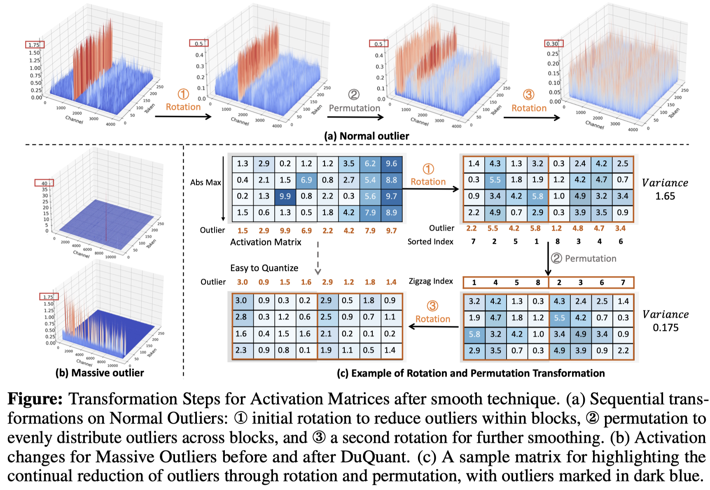
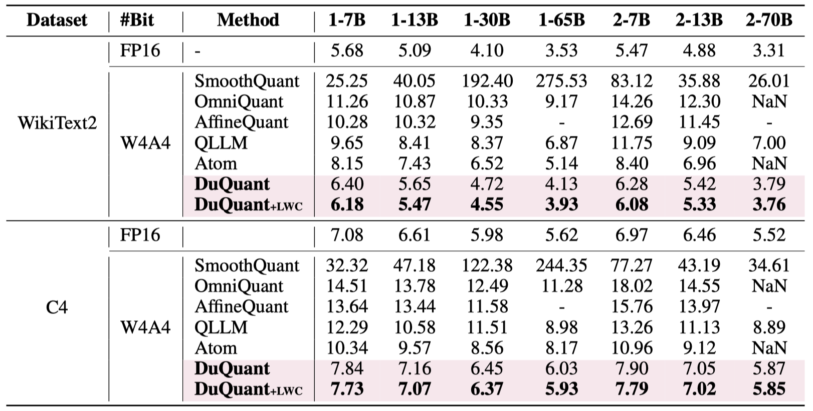
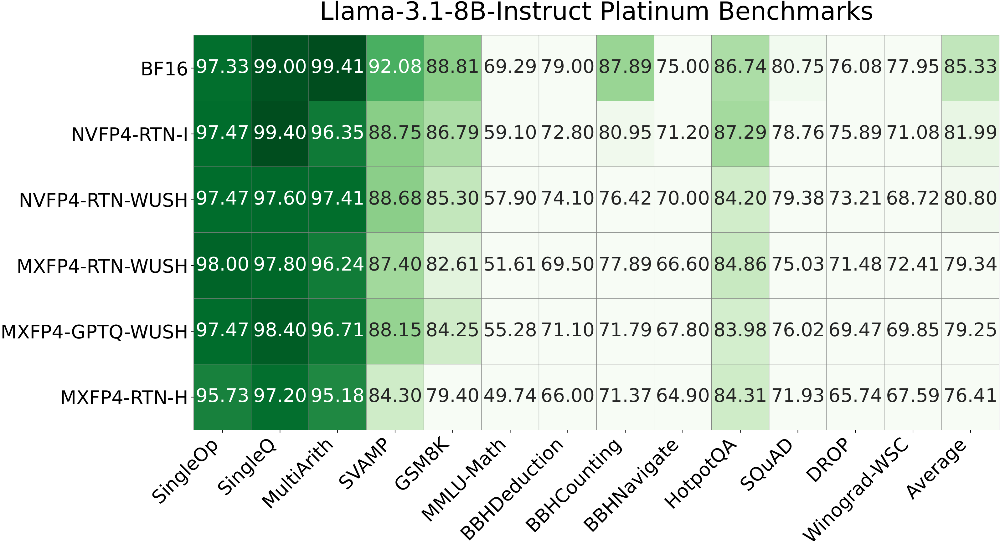

# AutoRound: channel permutations, mixed MXFP4/MXFP8 activations, and HMT

[中文](summary_CN.md) | [English PPT](slides_EN.pptx) | [English PDF](slides_EN.pdf) | [Chinese PPT](slides_CN.pptx) | [Chinese PDF](slides_CN.pdf) | [Evidence manifest](evidence.json)

**Research date: 2026-11-05. Code baseline: `5db1082901dfba6e710f46e11bcc00cad30a5af3`.**

**Scope: research and development design, not an implemented feature or performance report.** The user confirmed that HMT means a normalized Hadamard transform and Intel GPU/XPU is the primary target.
Labels distinguish **[Existing]** inspected code, **[Author-reported]** author-released figures/data/implementations, **[Design]** proposed implementation, and **[Exploration]** unverified hypotheses.
No model quantization, accuracy evaluation, or XPU performance benchmark was run for this report.

## 1. Conclusions and recommended route

Implement the requests as **two independently enabled features sharing one channel-transform plan**, not a new scalar datatype with an ambiguous name such as `mx_fp48`.

| Feature | Recommended MVP | Later extensions |
|---|---|---|
| F1: shuffle GEMM/grouped-GEMM input channels before MXFP4 quantization | Learn a fixed K-axis permutation offline; apply the same column permutation to activations and weights; regroup 32-element quantization blocks; all W4A4 | Joint block-HMT search, shared expert plans, hardware-constrained permutations |
| F2: gather activation input channels into mostly MXFP4 and a small MXFP8 subset | Select sensitive channels statically; one gather produces two contiguous partitions; **all weights remain MXFP4 by default**, activations are A4/A8 | Independently optional MXFP8 high-partition weights; dynamic partitions are research only |
| Optional HMT for both features | Partition first; normalized block HMT on the low-precision partition; start at dimension 32 | Compare 128/256/512, random signs, multiple rotations, and selection recalibrated after a full-input rotation |
| XPU deployment | Freeze numeric contracts and packed ABI before implementing decode-fused GEMM | Enable native FP4/FP8 only after the actual device and primitive pass capability checks |

**MicroMix** is the closest precedent: its public implementation already includes channel reordering, MXFP4/6/8 allocation, and Blackwell mixed GEMM. **DuQuant++** already applies fine-grained rotations to MXFP4.[R10][R04]
Do not claim the first shuffle/mixed-MXFP method. The useful differentiation is **AutoRound reconstruction-loss-driven discrete search, joint HMT/precision-budget optimization, MoE sharing/bucketing, and Intel XPU fusion**.

Recommended order: **numeric/capability discovery → F1 dense → F2 dense → AutoRound tuning → grouped/MoE → serialization/inference round trip → performance optimization**.
Each stage has a separate exit gate; accuracy improvement is not conditional on achieving a speedup.

## 2. Literature and implementations: evidence and transferable ideas

### 2.1 Evidence boundaries

Direct DNS access to arXiv, ACL Anthology, and external documentation hosts failed in this environment.
The inspected evidence consists of **pinned author repositories, relevant algorithm/kernel code, author-released paper-figure PDFs/PNGs, and original CSV data**; this is not a claim to have read every paper in full.
Full revisions, inspected files, hashes, and access dates for 13 sources are in [evidence.json](evidence.json); paper entry points are in section 16.
Unretrieved full-text ablations, hidden settings, and newer work cannot be treated as verified. This is not an exhaustive literature survey.

### 2.2 Directly relevant work

| Source | Inspected evidence | Relevance | Limits on transferring conclusions |
|---|---|---|---|
| Microscaling / OCP MX, [R01] | Shared exponents for 32 elements, FP4/FP8 formats; reference library explicitly emulates with higher-precision compute | Common formats, exponents, rounding, numeric reference | Emulation support is not native instruction support |
| RPTQ, 2023, [R02] | Reorder activation channels by range and quantize clusters; public code contains both KMeans and range-sorting paths | Cheap similar-magnitude grouping baseline; normalization/reorder fusion | INT results are not MXFP4 results |
| DuQuant, 2024, [R03] | Block rotation → zigzag permutation → another rotation; released method figure and PPL table | Compare clustering with outlier balancing; objectives differ around HMT | Random shuffling is not guaranteed to help |
| DuQuant++, 2026, [R04] | MXFP4 W4A4, dimension 32, fine-grained rotations, optional GPTQ | Direct MXFP4 baseline for F1+HMT | Public FP4 code has additional scale conventions; byte/export equivalence needs alignment |
| QuaRot, 2024, [R05] | Matched orthogonal rotations preserve the function; Hadamard implementation and paper figure | Fixed/random HMT baselines; identify absorbable transforms | INT4, KV, and architecture-wide benefits cannot be assigned directly to local MXFP4 |
| SpinQuant, 2024/25, [R06] | Random-rotation variability, Cayley optimization, author reproduction table | Multiple seeds and learned rotations as advanced baselines | Released HF reproduction is not identical to the paper's internal implementation |
| LLM.int8(), 2022, [R07] | INT8 bulk and separate 16-bit matrix multiplication for outlier features | F2 decomposition and correct summation boundaries | Neither MXFP4/MXFP8 nor performance evidence for this task |
| QUIK, 2023, [R08] | `MixedQLinear`, retained high-precision features, 4-bit inference kernels | Split branches, quantization/decode fusion, inference round trip | CUDA-specific implementation is not an XPU port |
| Atom, MLSys 2024, [R09] | Mixed precision, grouping, dynamic quantization, reorder kernels, serving evaluation | Fuse gathers with adjacent operations; include routing/reorder costs | README specifies RTX4090; its speedups are not Intel targets |
| MicroMix, 2025/ICLR 2026, [R10] | `micromix` branch: static sorting, ratio search, MXFP4/6/8; `w4a8.cu` uses MXFP8 activations × MXFP4 weights on SM120 | Closest F2 algorithm/packed-kernel precedent; omit FP6 from the MVP unless necessary | Its 128-channel alignment is not universal for XPU; no clear repository reuse license was established |
| FP-Quant / MR-GPTQ, 2025, [R11] | MXFP4/NVFP4, Hadamard/other transforms, real/pseudo quantization, QuTLASS | Separate rounding, compensation, transforms, fake and actual inference | NVFP4 is not MXFP4; NVIDIA kernels do not establish XPU speedups |
| WUSH, ICML 2026, [R12] | Data-aware non-orthogonal block transform, released figures/CSV, inverse-transpose code | Extend fixed HMT toward joint weight/activation statistics | Requires inverse-transpose compensation, not the orthogonal formula |
| oneDNN main branch, [R13] | Native-vs-conversion support by Intel GPU architecture; MXFP8 matmul tutorial | Current capability/backend reference | Datatype support does not guarantee arbitrary A8W4, scale layouts, or ragged grouped GEMM |

**Implementation caveats.** MicroMix `utilize.py:18–38` sorts statistics ascending, placing outlier channels last.
The heuristic and 128-channel alignment in `179–274` are implementation choices; select ratios using complete post-partition QDQ output error instead.
DuQuant++ `quantize/quantizer.py` uses `alpha=0.8` and `/FP4_SCALE` in `per_token_fp4`, with `FP4_SCALE=3/4`.
Such factors require a demonstrated global-scale/weight-compensation treatment; **do not silently describe the resulting effective scale as pure E8M0**.
Transfer the transformation ideas, not these numeric conventions without validation.

### 2.3 Verified quantitative evidence

**Author-released WUSH MXFP4 data:** Llama-3.1-8B-Instruct, macro accuracy over 13 Platinum tasks, percentages.
Average the 13 task accuracies within each record, then average the records for a method; this matches the author's plotting script.[R12]

| Method | Macro accuracy | CSV records |
|---|---:|---:|
| BF16 | 85.33 | 1 |
| MXFP4-RTN-H | 76.41 | 5 |
| MXFP4-RTN-WUSH | 79.34 | 5 |
| MXFP4-GPTQ-WUSH | 79.25 | 5 |

RTN-WUSH improves over RTN-H by **2.93 percentage points**, but remains **5.99 points below BF16**.
These data **do not establish that adding GPTQ improves every evaluation setting**. Record counts are not automatically verified independent random seeds.
These are author experiments, not measurements of the proposed features, this checkout, or XPU.
The original [CSV](assets/wush_platinum_bench.csv) supports recalculation; the presentation includes editable tables/charts.

**SpinQuant author HF reproduction:** LLaMA-3 8B, integer W4A4 with KV16, not MXFP4.[R06]

| Method | Zero-shot accuracy | WikiText-2 PPL, lower is better |
|---|---:|---:|
| FloatingPoint | 69.6 | 6.1 |
| QuaRot | 63.8 | 7.9 |
| SpinQuant | 65.8 | 7.1 |

**Updated RPTQ author table:** OPT-13B WikiText PPL is **10.13 / 10.90 / 12.74** for FP16 / W4A8 / W4A4; OPT-66B is **9.34 / 9.46 / 12.23**.[R02]
These integer results motivate studying low-bit activations and reordering; they are not a direct F2-vs-pure-MXFP4 comparison.

### 2.4 Original paper-related figures and data tables



Unmodified DuQuant author figure, [R03] `imgs/duquant.png`, MIT.
Illustrated outliers and variances are the author's example, not measurements for this task.



DuQuant author PPL table, [R03] `imgs/ppl.png`, MIT. `1-*` / `2-*` denote LLaMA-1 / LLaMA-2.
W4A4 denotes that work's integer experiments, not MXFP4. Original `NaN` and missing values are preserved.



Author-released version of WUSH paper figure 10, [R12], Apache-2.0. Rasterized from its single-page PDF without changing labels or data.

## 3. Existing AutoRound infrastructure and actual gaps

Paths refer to the fixed baseline above; do not build a parallel system around an assumed older layout.

| Existing location | Available capability | Required work |
|---|---|---|
| [`schemes.py:213–250`](../../../auto_round/schemes.py#L213), [`694–758`](../../../auto_round/schemes.py#L694) | MXFP4/MXFP8 presets exist; MXFP4 means W4A4, group 32; `from_dict` filters unknown fields | Explicitly register plan configuration so fields are not silently discarded |
| [`data_type/mxfp.py:231–289`](../../../auto_round/data_type/mxfp.py#L231), [`354–402`](../../../auto_round/data_type/mxfp.py#L354) | `quant_mx`, `quant_mx_rceil`, 4/8-bit QDQ and STE | Reuse numerics; add partition scheduling without breaking scalar-function return contracts |
| [`algorithms/composer.py:133–209`](../../../auto_round/algorithms/composer.py#L133) | Preprocessor/terminal-quantizer composition | Freeze plans before block reference collection; integrate reconstruction tuning |
| [`transforms/base.py:32–65`](../../../auto_round/algorithms/transforms/base.py#L32) | Pre/post hooks and reference invalidation | Correctly invalidate references and coordinate-dependent statistics |
| [`hadamard/config.py:60–94`](../../../auto_round/algorithms/transforms/hadamard/config.py#L60), [`apply.py:104–174`](../../../auto_round/algorithms/transforms/hadamard/apply.py#L104) | Configurable/layerwise HMT and inplace/transform dispatch | Reuse configuration/math; prevent double application |
| [`wrapper.py:617–655`](../../../auto_round/wrapper.py#L617), [`851–930`](../../../auto_round/wrapper.py#L851) | Activation QDQ; input hooks execute before quantization | Same permutation, partitions, and basis during tuning and fake evaluation |
| [`grouped_experts.py:60–87`](../../../auto_round/modeling/fused_moe/grouped_experts.py#L60), [`185–251`](../../../auto_round/modeling/fused_moe/grouped_experts.py#L185), [`372–391`](../../../auto_round/modeling/fused_moe/grouped_experts.py#L372) | Grouped QDQ/GEMM and quantization signatures | Online hooks/different signatures currently disqualify grouping; add explicit plan execution, not just Python hooks |
| [`ark/.../mxfp4_hadamard.py:354–399`](../../../auto_round_extension/ark/auto_round_kernel/mxfp4_hadamard.py#L354), [`452–583`](../../../auto_round_extension/ark/auto_round_kernel/mxfp4_hadamard.py#L452) | **Existing XPU HMT+MXFP4 packed-quantization primitive**, transform sizes 32–512 | Fuse channel indices/signs and split outputs; connect an actual GEMM consumer |
| [`xpu_mxfp4_hadamard_xmx.hpp:15–49`](../../../auto_round_extension/ark/auto_round_kernel/wrapper/include/xpu_mxfp4_hadamard_xmx.hpp#L15) | Optional XMX transform computation | This is FP16/BF16 DPAS for HMT, not proof of native MXFP4 GEMM |
| [`ark/.../__init__.py:3256–3420`](../../../auto_round_extension/ark/auto_round_kernel/__init__.py#L3256), [`sycl_tla_moe_mixed.hpp:1–35`](../../../auto_round_extension/ark/auto_round_kernel/wrapper/include/sycl_tla_moe_mixed.hpp#L1) | Expert-sorted activations, grouped scheduling, some decoded/fused paths | Current interface accepts FP16/BF16 activations; add packed-MX activation ABI, not just weight_bits |
| [`sycl_tla_moe_w4a8.hpp:1–65`](../../../auto_round_extension/ark/auto_round_kernel/wrapper/include/sycl_tla_moe_w4a8.hpp#L1) | Existing W4A8 means **INT4 storage / INT8 compute** | Do not relabel it MXFP4/MXFP8; preserve its partial hardware-validation caveats |
| [`qlinear_fp.py:67–145`](../../../auto_round/export/export_to_autoround/qlinear_fp.py#L67), [`export_to_nvfp_mx.py:63–143`](../../../auto_round/export/export_to_autoround/export_to_nvfp_mx.py#L63) | Packed MX weights/scales and export | Partitioned weights, indices, versions, pre-load buffer registration, shard persistence |
| [`inference/backend.py:712–801`](../../../auto_round/inference/backend.py#L712), [`992–1007`](../../../auto_round/inference/backend.py#L992) | ARK CPU/XPU registration/loading | These registrations are INT/weight-only, not mixed-MX activation support; add strict capability checks |

**Important:** inspected `mxfp4_hadamard_quant` references are bindings, wrappers, tests, and benchmarks; this does not establish automatic integration into a quantized model's dense/grouped MXFP4 GEMM.
Some ARK FP8 grouped headers explicitly say `NEEDS-HARDWARE-VALIDATION`. Reuse scheduling ideas without presenting code existence as production readiness or verified performance.

## 4. Shared algebra and numeric contracts

### 4.1 Paired K-axis transforms

Use row-vector conventions: `X[M,K]`, `W[N,K]`, `Y=X W^T+b`.
Let `p` be a complete permutation without repeated indices and `P` its matrix:

$$
X_p=X[:,p]=XP,\qquad W_p=W[:,p]=WP,\qquad X_pW_p^T=XW^T.
$$

**Shuffling only activations or only weights is incorrect.**
This permutes input/K channels, not token/M-axis expert routing, and requires no inverse permutation on the final N-dimensional output.

For normalized Hadamard/orthogonal `R` with `RR^T=I`, `X'=XPR` and `W'=WPR` preserve the output.
Random signs may use `R=D H_b`; both sides must share signs and execution order.
For a general invertible, non-orthogonal `T`, such as WUSH, compensation is **`X'=XT`, `W'=W T^{-T}`**, not multiplication by `T` on both sides.

### 4.2 Why reordering can improve accuracy

MXFP4 shares a scale across 32 contiguous elements. Changing **cross-block membership** changes scales and quantization error.
Within-block permutations or permutations of entire 32-element blocks should preserve outputs when no other transform intervenes and quantization rules match; these are necessary negative controls.
Random shuffling has no guarantee. Without HMT, grouping similarly sized channels is a sensible candidate; with HMT, distributing outliers across rotation blocks may be preferable.
These are competing experimental objectives, not one universal rule.

### 4.3 Freeze an exportable numeric profile

MXFP4 uses E2M1 magnitudes `{0, 0.5, 1, 1.5, 2, 3, 4, 6}` and one E8M0 scale per 32 elements.
Default MXFP8 to E4M3; explicitly select and separately validate E5M2. MXFP8 is not plain FP8 without block scales.

Prefer alignment with the existing ARK frozen profile: `e=clamp(floor(log2(amax))-2,-127,127)`, `s=2^e`, round-to-nearest-even, saturation, even elements in the low nibble, and canonical zero code `0x0`.
Use the existing all-zero-block encoding.
Core `quant_mx`, `rceil`, and CUDA HMT QDQ do not have identical scale/zero-block conventions. Choose one profile across calibration, tuning, packing, and inference rather than silently interchanging them.

Compute statistics, transforms, and scales in FP32. Specify NaN/Inf rejection/diagnostics, subnormals, reserved E8M0 `255`, and boundary ties.
Test the FWHT path against its frozen butterfly order at packed-byte level; retain the existing tolerance-based contract for XMX transforms, **without promising byte identity to FWHT**.
Never omit or duplicate Hadamard normalization by `1/sqrt(b)`.

## 5. F1: permutation plus MXFP4 algorithms

### 5.1 Calibration and candidates

Collect streaming FP32 statistics by input-equivalence class: per-channel RMS, mean absolute value, maximum/quantile, tail frequency, weight-column norms, and quantization residuals; optionally block covariance.
Q/K/V and gate/up projections sharing an input should jointly score and reuse transforms instead of creating redundant gathers.

Start with:

1. Identity, seeded random, within-block/whole-block negative controls.
2. Sort activation `log2(RMS+eps)` or quantiles to group similar magnitudes; test weight-norm weighting.
3. RPTQ-style range grouping and DuQuant-style sorted zigzag outlier balancing, combined with HMT.
4. Hardware-constrained local swaps: 128/256/512-channel windows, 32-element block exchanges, or bounded permutation displacement.

Do not optimize activation `amax` alone. Score complete quantized-layer normalized reconstruction:

$$
L(P,R)=\frac{\mathbb E\|XW^T-Q_A(XPR)Q_W(WPR)^T\|_F^2}
{\mathbb E\|XW^T\|_F^2+\epsilon}.
$$

Normalize and combine losses of consumers sharing a transform so a larger projection does not dominate purely by output size.

### 5.2 Integration with AutoRound

Freeze the discrete plan before optimizing existing weight-rounding/scale parameters; changing permutations every SignSGD step changes gradient and group-scale semantics.
Initially use RTN candidate screening → short AutoRound runs on the best 2–4 → separate selection data → final tuning.
Changing a plan requires synchronized weights, statistics/covariance, tuning tensors, and caches.
The simpler MVP restores original layer weights and reinitializes tuning state for each new plan.

## 6. F2: gathered mostly-A4 plus small-A8 partitions

### 6.1 Explicit precision semantics

Let `S8` be high-precision channels, `S4` its complement, and `p=[S4,S8]`. Rebuild independent 32-element blocks in each partition.
By default, only activation precision changes:

$$
\hat Y=Q_4(X_{S4})Q_4(W_{S4})^T+
Q_8(X_{S8})Q_4(W_{S8})^T+b.
$$

The high branch is **W4A8**. An optional **W8A8** branch must be an independent switch/ablation: requantize its weights from the original floating-point model to MXFP8.
Do not attribute its additional budget/benefit to the default feature.
Branches sum along K; they are not two full-K GEMMs or a full main result plus double-counted high-channel products. Add bias once.

If hardware supports only MXFP8×MXFP8, **losslessly expand W4 element codes to FP8 element codes** while preserving E8M0 scales.
Finite E2M1 values are exactly representable in E4M3. This changes operand representation, **not weight quantization accuracy**.
Validate scale layout, overflow/subnormal behavior, and report extra resident memory when expanded weights are cached rather than reporting checkpoint size alone.

### 6.2 Selecting the small subset

Screen with `E[x_j^2] * ||W[:,j]||_2^2`, tail magnitude, or A4→A8 error reduction, then rerank using **complete post-partition QDQ reconstruction**.
A more targeted proxy is:

$$
s_j=\|Q_4(W)[:,j]\|_2^2\,
\mathbb E[(Q_4(x_j)-x_j)^2-(Q_8(x_j)-x_j)^2].
$$

This approximates a fixed grouping/scale setting only. Moving channels changes activation/weight group scales and errors of other channels.
Recompute grouped error; per-channel proxy scores are not additive true gains.
Compare maximum, quantiles, second moments, quantization-error gain, and blockwise marginal gain. Largest magnitude need not mean highest value for an A8 upgrade.

Use static per-layer masks by default. Sweep `rho∈{0,1%,2%,3.125%,6.25%,12.5%,25%}`, reporting aligned actual ratios.
For a global budget, use discrete knapsack or Lagrangian allocation over per-layer gain/measured-cost curves.
Track minimum expert coverage and conservative handling of cold experts.

### 6.3 Alignment and actual cost

Align `K8` to at least 32; kernel K tiles and partition HMT dimensions may require more.
Pad `K4/K8` independently and record logical/padded lengths; never let one 32-element scale block straddle precision formats.

| K | Target A8 ratio | K8 aligned only to 32 | Actual A8 ratio |
|---:|---:|---:|---:|
| 768 | 1% | 32 | 4.17% |
| 2048 | 1% | 32 | 1.56% |
| 4096 | 1% | 64 | 1.56% |
| 4096 | 5% | 224 | 5.47% |

Ignoring padding, indices, and layout overhead, activation storage is `4+4*rho+8/32 = 4.25+4*rho` bits/element.
At `rho=6.25%`, this is **4.50 bits**, **5.88%** above pure MXFP4's 4.25.
This is theoretical payload, not measured latency/bandwidth overhead. Default W4A8 does not automatically increase checkpoint weight bitwidth.

## 7. Combining HMT with the features

| Variant | Exact order | Benefits and risks |
|---|---|---|
| H0 | Permute/partition → quantize, no HMT | Isolates F1/F2 benefits and gather cost |
| H1, recommended start | Select original-basis high channels → gather partitions → block HMT on low partition → A4/A8 | Sensitive channels are not mixed back into low precision; cheap and interpretable |
| H2 | Full-input HMT → recalibrate/select in rotated coordinates → gather → A4/A8 | Protect channels still difficult after rotation; old-basis masks are invalid |
| H3 | Partition → independent HMT in both partitions → A4/A8 | Both partitions may benefit; small high K can increase padding/overhead |
| H4 | Rotate → zigzag permutation → rotate | DuQuant-style baseline; two transforms are not free |

H1 is `T=P diag(R4,I8)`; H3 is `T=P diag(R4,R8)`, both allowing matched orthogonal compensation.
H2 instead uses `T=R P`; **`PR` and `RP` generally differ**.
Persist `mask_basis` and `transform_order`.

Compare fixed H32 and random-sign H32 first, then 128/256/512; the quantization group remains 32.
**Transform block size need not equal quantization block size.**
Learned rotations are later exploration: reuse existing SpinQuant integration only after checking XPU, MoE, serialization, and dense/low-rank matrix costs; do not presume production readiness.

For non-power-of-two lengths, initially zero-pad each partition to a supported dimension and retain every compensated coordinate; do not discard padding coordinates after HMT.
Known Hadamard factorizations/small-tail transforms are later options.
Place HMT only at compensable linear inputs; do not move it across SiLU/GELU, RoPE, residual sums, or the router without proof.

## 8. Dense/grouped GEMM and Intel XPU implementation

### 8.1 Dispatch by GPU generation, not merely `xpu=True`

The pinned oneDNN support matrix is below.[R13]
“Conversion” means computation using a higher-precision datatype.
“Native” refers to datatype compute support, **not a guarantee for a particular mixed/grouped primitive**.

| Architecture | FP8 | FP4 E2M1 |
|---|---|---|
| Xe-HPC, including Data Center GPU Max | Conversion | Conversion |
| Xe2-HPG, including Arc B series | Conversion | Conversion |
| Xe3-LPG | Conversion | Conversion |
| Xe3p-LPG | Native | Conversion |
| Xe3p-XPC | Native | Native |

M0 records actual GPU/device id, driver, PyTorch, oneAPI/compiler, oneDNN/ARK/CUTLASS-SYCL revisions, and target ISA.
Create primitives for every candidate precision combination, validate numerics, microbenchmark, and identify actual instruction/conversion paths.
Do not turn `dnnl_unimplemented` into silent success or infer installed-release support from main-branch documentation.

### 8.2 Three implementation layers

**Reference:** PyTorch FP32/CPU defines transform/QDQ oracles.
Tuning can use concatenated QDQ tensors and a single high-precision GEMM; two actual low-bit kernels are not prerequisite.
Retain STE and differentiable gathers/partitions.

**Conversion-compute devices:** reuse ARK/SYCL scheduling, unpack nibbles/apply scales during loads, then feed FP16/BF16 DPAS.
Avoid a full `[E,K,N]` decoded workspace.
MXFP4 codes are not INT4 codes and cannot be passed to the existing integer W4A8 kernel.
K-varying scales require per-group application/accumulation in the mainloop, not one full-K epilogue.
Potential gains are storage, memory traffic, and fusion; **do not promise 4-bit arithmetic peak throughput**.

**Native devices:** use supported native block-scaled shape/scale/operand combinations.
Evaluate native A8W4, lossless W4→W8 code expansion followed by A8W8, and explicit decode fallback.
Start with two GEMMs plus summation, then optimize shared FP32 accumulation/epilogue.
Concurrent writes need synchronization or separate partial buffers. Add bias once.

Target preprocessing fusion: one load performs `row routing + channel gather + sign + HMT + quantize + pack`, writing two contiguous packed partitions.
Share QKV/gate-up preprocessing where possible; experimental Python hooks are not the optimized deployment interface.

### 8.3 Grouped GEMM / MoE specifics

Separate **M-axis** expert token sorting from **K-axis** channel reordering.
Preserve top-k weights, original token ids, and scatter/reduce correspondence.

| Plan granularity | Execution | Recommended stage |
|---|---|---|
| Shared `p,S8,H` by input-equivalence class/expert group | Combine channel gather with expert sorting; gate/up share preprocessing | MVP |
| Per-expert masks with fixed K8 buckets | Expert-specific indices after sorting; bucket by `(K4_pad,K8_pad,profile,H)` | Second stage |
| Arbitrary per-expert K8 or dynamic token masks | Ragged dual branches, complex routing/cache/graph capture | Research only |

Weight calibration statistics by actually routed token counts; record unobserved/rare experts.
Forced coverage supplements observations but must not silently replace real traffic weights.
Down-proj consumes expert-specific intermediate activations and cannot unconditionally reuse gate/up plans.

Include plan id, partition lengths, profile, and transform order in grouped signatures.
Replace disqualifying online hooks with explicit plan stages.
Different plans can be bucketed but cannot share scales/indices solely because bitwidths match.
Cover empty experts, single-expert hotspots, long tails, and small-M decode; avoid two Python GEMMs per expert.

## 9. Configuration, tuning, export, and reload design

**[Design: this is not a currently callable API.]**
Add a small `ChannelTransformConfig` and a single `ChannelPartitionPlan`, coordinating block preprocessing/wrappers inside the existing composer.
Keep the `MXFP4/MXFP8` scalar registry unchanged.
Integrate through explicit schemas rather than unknown fields filtered by `QuantizationScheme.from_dict()`.
F1/F2/HMT default off; preserve old models/configuration behavior.

Proposed checkpoint metadata fragment:

```json
{
  "channel_plan_version": 1,
  "numerical_profile": "ark_mxfp4_rne_v1",
  "mask_basis": "original_input",
  "transform_order": ["gather_partition", "block_hadamard", "quantize_branches"],
  "logical_k": 4096,
  "k4": 3840,
  "k8": 256,
  "padded_k4": 3840,
  "padded_k8": 256,
  "low_act_format": "mx_fp4_e2m1",
  "high_act_format": "mx_fp8_e4m3",
  "low_weight_format": "mx_fp4_e2m1",
  "high_weight_format": "mx_fp4_e2m1",
  "hadamard_low": 32,
  "hadamard_high": 0,
  "permutation_buffer": "channel_permutation",
  "sign_buffer": "channel_sign",
  "backend_policy": "explicit_capability_check"
}
```

The profile name is a proposed version identifier, not an existing registry key.
Store indices, signs, partitioned packed weights/scales as safetensors buffers.
Persist plan hashes, whether weights were transformed offline, logical dimensions/layout, and shared-plan relationships.
A seed alone is insufficient: store actual signs/permutations or versioned, verifiable reconstruction to avoid RNG-version drift.

| Surface | Required integration |
|---|---|
| Preprocessing/calibration | Apply once; idempotency markers; recollect coordinate-dependent statistics; invalidate references as required |
| AutoRound wrapper | Same basis/partitions for `_qdq_act` and weight QDQ; STE/scale tuning; synchronized shapes/tuning state |
| Grouped tuning | Plan signatures, buckets, expert statistics; preserve batched weight-QDQ gradients |
| Export | Partitioned QuantLinear representation and format checks; never export mixed plans as ordinary single-partition MXFP4 |
| Immediate/shard saving | Inject plan buffers before shard writes/offload; match whole-model persistence |
| Reload | Register buffers before state loading; validate indices/dimensions/hashes; restore transforms exactly once |
| Backend | Register packed-activation ABI, support matrix, explicit fallback policy, actual-path logging |
| TP/EP/fused layers | MVP uses rank-local K permutations; cross-rank changes need communication proofs; consistent fused QKV/gate-up, conversion, and regex layer_config handling |

Missing/repeated/out-of-range indices, unknown profiles, damaged checkpoints, and unsupported hardware must produce explicit errors.
Only explicitly enabled, logged QDQ/reference fallback is acceptable; avoid success-shaped silent degradation.

## 10. Search and exploration algorithms

### 10.1 Unified alternating search

```text
Collect routing-weighted statistics per decoder block; separate calibration/selection/final data
Generate identity, magnitude-clustered, zigzag, locality-constrained permutations
Screen no-HMT / H32 / random-sign H32 with a small budget
For each candidate:
    Estimate A4→A8 gain in the correct coordinate basis
    Align K8 candidates; rebuild partitions and all group scales
    Score complete W4A4 + W4A8 QDQ layer outputs
Swap boundary channels/groups; retain only selection-loss improvements
Run short AutoRound tuning on the best 2–4 plans; rescore instead of reusing RTN scores
Select Pareto plans using measured XPU cost and a model-wide budget
Freeze, tune, export, and validate reload
```

Use `L_reconstruction + lambda*T_measured + mu*B_resident`, including gather/HMT/quantization/both GEMMs/summation/routing in `T`, and caches/workspaces in `B`.
Without hardware measurements report quality/bytes Pareto points, not invented latency targets.
The permutation space is `K!`; use O(K log K) initialization plus bounded local swaps, recomputing affected groups under HMT/group constraints.

### 10.2 Prioritized exploration

| Priority | Direction | Testable question |
|---|---|---|
| P0 | A8 marginal-gain selection rather than maximum alone | Does complete reconstruction improve at the same actual K8? |
| P0 | Complementarity/substitution between HMT and A8 | Does HMT lower the best A8 budget, and does the combination beat either alone? |
| P0 | Locality-constrained permutations | Can most accuracy gains survive with less random-gather bandwidth loss? |
| P0 | Shared vs expert-specific MoE plans | Does added accuracy justify top-k preprocessing duplication? |
| P1 | Exponent-boundary-aware ordering | Do power-of-two scale boundaries improve decisions beyond magnitude statistics? |
| P1 | Model-wide budget allocation | Do only a few down-proj layers/experts need A8? |
| P1 | SpinQuant-like learned rotations or WUSH transforms | Can they beat fixed HMT at matched actual kernel cost? WUSH needs inverse transpose |
| P2 | Per-token/tile dynamic masks | Can transient outliers be handled without breaking weight gathers or graph capture? |
| P2 | W8 high branch, compensation, low-rank side paths | Separate activation/weight error and account for extra budget |
| P2 | MXFP6 | Expand only with verified device/kernel value, not a third MVP ABI |

## 11. Experiment matrix and evaluation protocol

**Models:** tiny random Linear/MLP and existing tiny OPT/Qwen fixtures, then small Qwen3, Llama-3.1-8B-class dense, and Qwen3-MoE-class models.
Use authorized alternatives for gated models; do not automatically download/execute remote custom model code.

**Data:** start with 128×2048 calibration tokens and block streaming if necessary.
Separate calibration, selection, and final WikiText-2/C4/zero-shot data.
Include code/math, long-context, and distribution-shift samples; record real MoE routing coverage and at least three explicitly recorded seeds.

| Axis | Required controls/values |
|---|---|
| Method | BF16; existing MXFP4-RTN; existing MXFP4-AutoRound; F1; F2; F1+F2; each ±HMT |
| Budget fairness | Matched actual K8, weight bits, calibration data, tuning iterations; separate optional W8A8 |
| HMT | None, H32, random-sign H32; later 128/256/512; pre/post-HMT selection |
| Permutations | Random, magnitude grouping, zigzag, error-driven, locality-constrained; within/whole-block controls |
| Operator shapes | M=1/8/32/128/1024; real K/N including K=768/2048/4096/11008 |
| MoE | E=8/64/128, top-k=2/8; balanced, long-tail, empty, hotspot routing |
| Numeric profile | One fixed default; floor/rceil only separate ablations |

**Accuracy:** per-layer normalized MSE, SQNR, similarity, tail error, saturation/zeroing; full-model PPL, per-task/macro scores, long-context behavior.
Mean activation MSE alone does not establish model accuracy.

**Performance:** warm-up followed by median/p95 using synchronized XPU events on the same device.
Report kernel-only, complete projection, MoE block, prefill/decode, TTFT/TPOT, and tokens/s.
Break down routing, gather, HMT, quantization, GEMM4, GEMM8, summation, scatter.
Report peak/resident memory, packed bytes, expanded-weight caches, and workspace.
Do not substitute padded `torch.bmm`, matmul-only timing, or different memory budgets for the end-to-end baseline; include batching and genuinely uneven routing.

## 12. Correctness tests and proposed acceptance gates

**These are proposed gates, not achieved results.**

| Level | Tests and exit criteria |
---|---|
| Algebra | Tiny finite FP64 paired permutation/orthogonal/inverse-transpose cases, e.g. max absolute error <1e-10; negative tests catch one-sided transforms |
| Encoding | Group-32 ties, signed/canonical zero, zero groups, extremes, subnormals, NaN/Inf policy; FWHT packed bytes match its reference |
| Partitions | Empty/full S8, minimum K8, rejected duplicate/missing/out-of-range indices, unaligned K/tails, regrouped scales, one bias, retained padded coordinates |
| Tuning | Gather/STE gradients match reference; frozen plan; disabled features preserve output/export behavior |
| Grouped | Per-expert reference, empty/skewed/top-k routing, shared/independent plans, signature buckets, observable hook fallback |
| GEMM | Tolerances for identical quantized inputs; separate FP32/BF16 and XMX/FWHT contracts; do not demand byte identity across accumulation orders |
| Lifecycle | quantize→save→load→generate; immediate/shard saving; meta/offload; old checkpoints; rank-local TP; explicit unsupported-backend failure |
| Accuracy research gate | On two dense and one MoE model, at least 20% lower median layer reconstruction error on separate selection data; no material final PPL/task regression and at least one improvement |
| Engineering gate | Start with K8≤6.25% bucket; complete-projection latency ≤1.10× same-device MXFP4 baseline; release based on full-model quality/cost Pareto |

Compute task confidence intervals appropriately over samples/seeds.
The 20% and 1.10× values are adjustable **project acceptance proposals**.
On conversion-only hardware, a valid outcome can be “accuracy/compression succeeds, low-bit arithmetic acceleration does not.”

Place future tests in this checkout's actual `test/unit/common/` and `test/unit/test_xpu/` structure.
Reuse `auto_round_extension/ark/test/` for hardware benchmarks and integration/e2e tiers for larger models.
Existing reference commands for later implementation (**not run for this report**):

```bash
pytest test/unit/common/algorithms/transforms/hadamard/test_hadamard_apply.py -q
pytest test/unit/test_xpu/transform/test_hadamard.py -q
pytest auto_round_extension/ark/test/test_mxfp4_hadamard.py -q
pytest auto_round_extension/ark/test/test_moe_prefill_accuracy.py -q
```

Add selectors for new partition/plan tests only after those tests exist.

## 13. Development work, dependencies, and estimates

These are **engineering estimates, not schedule commitments**.
They depend on actual devices, toolchains, and profiles; algorithm/kernel engineers can overlap some work.

| Stage | Deliverable | Dependencies | Estimate |
|---|---|---|---|
| M0 | Hardware matrix, numeric profile, packed ABI, baseline | Actual XPU/toolchain | 2–3 person-days |
| M1 | F1/F2 CPU reference, validation, no-HMT dense, negative controls | M0 | 4–6 person-days |
| M2 | Reused HMT, search, AutoRound wrapper/statistics integration | M1 | 5–8 person-days |
| M3 | Fused XPU gather/quantization, dense dual branch, profiling | M0/M1; HMT integration needs M2 | 6–10 person-days |
| M4 | Shared grouped plans, routing fusion, bucketing, decode | M2/M3 | 6–10 person-days |
| M5 | Versioned export/reload, shard/TP, evaluation/docs | M2/M3; MoE acceptance needs M4 | 5–8 person-days |

Separate contributions into reference/schema, calibration/search, wrapper/composer, XPU dense, grouped, export/backend, and evaluation/docs.
Design persistence from M0 rather than repairing it after kernels are finished.
If mixed primitives are unavailable, explicitly switch to decode fusion and assess its value; do not continue planning around unattainable native-FP4 peak numbers.

## 14. Risks, reliability, and compliance

| Risk | Mitigation |
|---|---|
| Presenting prior art as a new invention | Cite MicroMix, DuQuant++, RPTQ, Atom/QUIK; focus contributions on AutoRound/XPU/MoE |
| Treating attractive paper charts as new-feature results | Label source, model, format, metric; separate author reports, theory, and targets |
| HMT dispersing protected channels back into low precision | Persist mask_basis; calibrate H1/H2 separately |
| Gather/dual launches consuming gains | End-to-end cost, locality constraints, shared preprocessing, buckets, small-M dispatch |
| Rounding/extra scales obscuring results | Freeze E8M0 profiles; byte/tolerance tests; distinguish MXFP4 from NVFP4 |
| Hooks silently disabling grouping | Explicit plan stages, path logs, dispatch-aware performance checks |
| Calibration overfit/cold experts/drift | Separate data, routing coverage, budget sensitivity, conservative fallback |
| Successful export but lost transforms on reload | Schema versions, hashes, pre-shard buffer injection, round-trip tests |
| Model/data/execution safety | No uploads of models/calibration data; authorized data; do not execute fetched third-party code; safetensors rather than pickle plans |
| Unclear image/code licenses | Reproduce only selected MIT/Apache author assets; no MicroMix/Atom artwork/code or noncommercial SpinQuant figures |

Reuse permission is based on **selected files in the author repositories**, not a blanket license for complete papers or all artwork.
Retain [notices](third_party/THIRD_PARTY_NOTICES.txt), [MIT](third_party/DuQuant_MIT.txt), and [Apache-2.0](third_party/Apache-2.0.txt).
Full licenses are included in final-slide speaker notes and embedded as PDF attachments.
The deck is macro-free `.pptx` with embedded local images, not externally fetched pictures.
These measures improve auditability, not legal certainty or model-safety guarantees.

## 15. Deliverables and reproduction

| File | Purpose |
|---|---|
| [summary_CN.md](summary_CN.md) / [summary.md](summary.md) | Equivalent Chinese/English research and development design |
| [slides_CN.pptx](slides_CN.pptx) | 36-slide editable Chinese presentation with author figures, editable data tables/charts, architecture/algorithm diagrams, source notes |
| [slides_CN.pdf](slides_CN.pdf) | Rendered version of the same deck |
| [slides_EN.pptx](slides_EN.pptx) / [slides_EN.pdf](slides_EN.pdf) | Equivalent 36-slide, English-only editable PPT and rendered PDF; slide text, tables, chart labels, notes, and metadata are in English |
| [slides_manifest.json](slides_manifest.json) | Page numbers, titles, sections, and per-slide source IDs |
| [slides_manifest_EN.json](slides_manifest_EN.json) / [slides_EN_content.json](slides_EN_content.json) | English page/source manifest and auditable English content mapping |
| [evidence.json](evidence.json) | Pinned sources, source/asset hashes, licenses, data, evidence limits |
| [build_presentation.py](build_presentation.py) / [requirements.txt](requirements.txt) | Offline deck generation, PDF license attachment, integrity checks |
| [assets](assets) / [third_party](third_party) | Licensed figures, original CSV, notices |

Rebuild from this directory; these are documentation-only dependencies, not runtime project changes:

```bash
python -m pip install -r requirements.txt
python build_presentation.py
libreoffice -env:UserInstallation=file:///tmp/autoround-slides-profile \
  --headless --convert-to pdf --outdir . slides_CN.pptx
python build_presentation.py --finalize-pdf
python build_presentation.py --check
python build_presentation.py --language EN
libreoffice -env:UserInstallation=file:///tmp/autoround-slides-profile-en \
  --headless --convert-to pdf --outdir . slides_EN.pptx
python build_presentation.py --language EN --finalize-pdf
python build_presentation.py --language EN --check
```

LibreOffice, Noto Sans CJK SC, and Liberation Sans fonts must be installed.
The build script does not use the network or execute author-repository code.
Actual rendering governs PDF layout; figure/CSV integrity is auditable against the manifest.
English checks also reject residual Chinese in slides, chart data, speaker notes, and metadata.
Original author figures are already in English; their assets and data remain unchanged.
Session-relative chat links are not public download URLs. After publication, use GitHub raw-file links pinned to a pushed commit.
Download PPTX files and open them in PowerPoint/Impress; do not rely on GitHub slide previews.
Implementation should begin with M0/M1, not a claim of accuracy/speed gains based on author figures.

## 16. Paper entry points and pinned implementations

Links identify papers and **inspected pinned author implementations**; see section 2.1 for full-text access limits.

| ID | Paper/reference | Inspected revision |
|---|---|---|
| R01 | [Microscaling Data Formats, 2310.10537](https://arxiv.org/abs/2310.10537) | [microxcaling@7bc4195][R01] |
| R02 | [RPTQ, 2304.01089](https://arxiv.org/abs/2304.01089) | [RPTQ4LLM@9619069][R02] |
| R03 | [DuQuant, 2406.01721](https://arxiv.org/abs/2406.01721) | [DuQuant@d56cfc6][R03] |
| R04 | [DuQuant++, 2604.17789](https://arxiv.org/abs/2604.17789) | [DuQuant-v2@6c13ec0][R04] |
| R05 | [QuaRot, 2404.00456](https://arxiv.org/abs/2404.00456) | [QuaRot@5008669][R05] |
| R06 | [SpinQuant, 2405.16406](https://arxiv.org/abs/2405.16406) | [SpinQuant@8f47aa3][R06] |
| R07 | [LLM.int8(), 2208.07339](https://arxiv.org/abs/2208.07339) | [bitsandbytes@a616886][R07] |
| R08 | [QUIK, 2310.09259](https://arxiv.org/abs/2310.09259) | [QUIK@9558d71][R08] |
| R09 | [Atom, 2310.19102](https://arxiv.org/abs/2310.19102) | [Atom@7e3618b][R09] |
| R10 | [MicroMix, 2508.02343](https://arxiv.org/abs/2508.02343) | [micromix branch@c57370b][R10] |
| R11 | [FP-Quant, 2509.23202](https://arxiv.org/abs/2509.23202) | [FP-Quant@d2e3092][R11] |
| R12 | [WUSH, 2512.00956](https://arxiv.org/abs/2512.00956) | [WUSH@0b69f66][R12] |
| R13 | [oneDNN datatype/hardware limits][R13] | `41494503bcbd60a761c0965ecb8ed6e57922974b`; MXFP8 matmul tutorial also inspected |

[R01]: https://github.com/microsoft/microxcaling/blob/7bc41952de394f5cc5e782baf132e7c7542eb4e4/README.md
[R02]: https://github.com/hahnyuan/RPTQ4LLM/blob/96190691f02be6b27ba24d5a73574dbf9a8336c6/README.md
[R03]: https://github.com/Hsu1023/DuQuant/blob/d56cfc6fe97c34c0eb100fec82fe439865905679/README.md
[R04]: https://github.com/Hsu1023/DuQuant-v2/blob/6c13ec07a3241f2d4ad6415a06403aef43919db9/README.md
[R05]: https://github.com/spcl/QuaRot/blob/5008669b08c1f11f9b64d52d16fddd47ca754c5a/README.md
[R06]: https://github.com/facebookresearch/SpinQuant/blob/8f47aa3f00e8662caf1a484153920a07e5281c3a/README.md
[R07]: https://github.com/bitsandbytes-foundation/bitsandbytes/blob/a616886cacf86701514f0cb1d6be760f967481c0/README.md
[R08]: https://github.com/IST-DASLab/QUIK/blob/9558d7121c698174fc93940e0b52c38c746c97ea/README.md
[R09]: https://github.com/efeslab/Atom/blob/7e3618b1a7a7c86e1c93cc909b1510c046d76ac6/README.md
[R10]: https://github.com/lwy2020/MicroMix/blob/c57370bc38f999e1f75aada9c4b8a85baa44aaae/README.md
[R11]: https://github.com/IST-DASLab/FP-Quant/blob/d2e3092f968262c4de5fb050e1aef568a280dadd/README.md
[R12]: https://github.com/IST-DASLab/WUSH/blob/0b69f66cb88aae673d63ae8b5fd96ac751c5a957/README.md
[R13]: https://github.com/uxlfoundation/oneDNN/blob/41494503bcbd60a761c0965ecb8ed6e57922974b/doc/common_concepts/data_types.md
