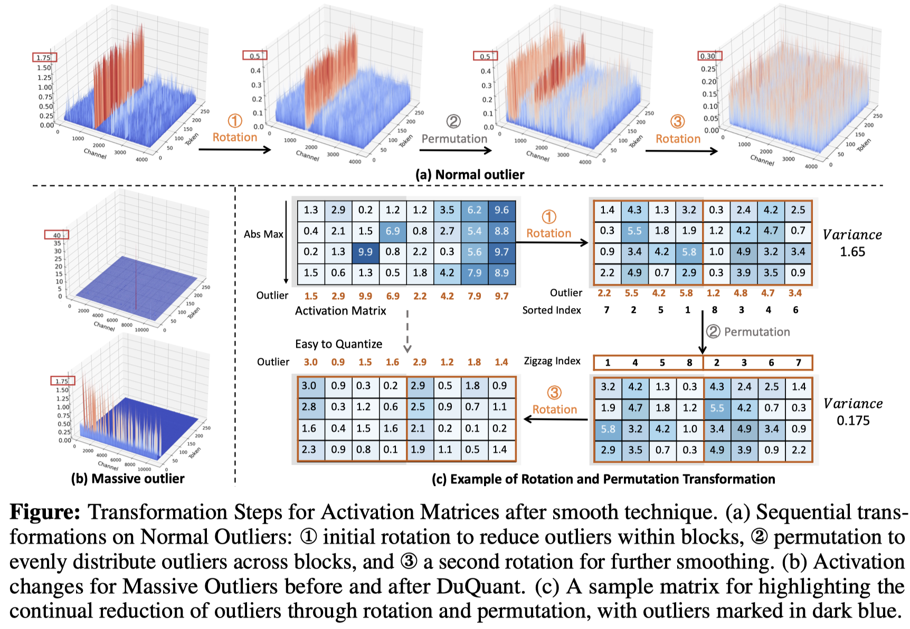
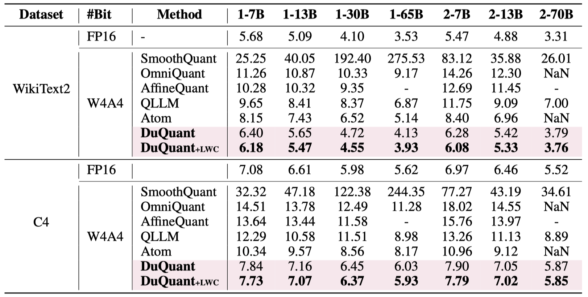
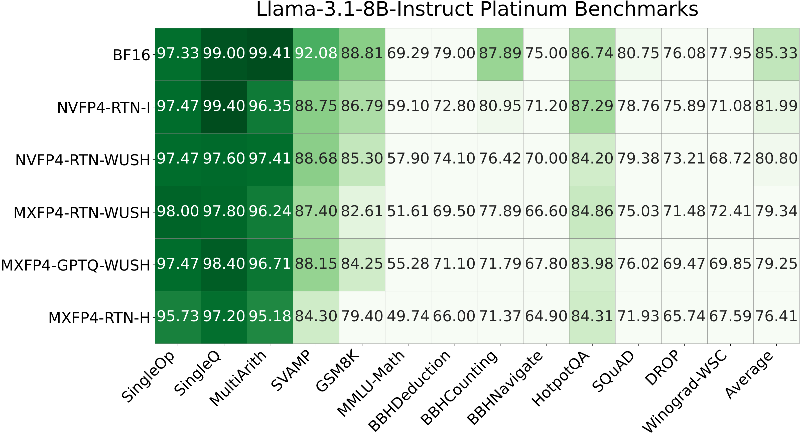

# AutoRound：通道重排、MXFP4/MXFP8 混合激活与 HMT 设计总结

[English](summary.md) | [中文 PPT](slides_CN.pptx) | [English PPT](slides_EN.pptx) | [中文 PDF](slides_CN.pdf) | [English PDF](slides_EN.pdf) | [证据清单](evidence.json)

**调研日期：2026-11-05。代码基线：`5db1082901dfba6e710f46e11bcc00cad30a5af3`。**

**范围：研究与开发设计，不是已实现功能或性能报告。** 用户已确认 HMT 指归一化 Hadamard Transform，主要目标是 Intel GPU/XPU。本文区分：
**【现有】** 已核验的代码；**【作者报告】** 论文作者公开的图表、数据或实现；**【设计】** 拟开发方案；**【探索】** 需要实验验证的假设。
本次未运行模型量化、精度评测或 XPU 性能测试。

## 1. 结论与推荐路线

两个需求应做成**同一份通道变换计划的两个可独立开启的功能**，而不是新增一个含义不清的 `mx_fp48` 标量数据类型。

| 功能 | 推荐 MVP | 后续扩展 |
|---|---|---|
| F1：GEMM/grouped GEMM 输入通道 shuffle 后 MXFP4 量化 | 离线学习固定 K 轴置换；激活和权重列做相同置换；重组 32 元素量化块；全部 W4A4 | 与块 HMT、共享专家计划、硬件约束置换联合搜索 |
| F2：activation 输入通道 gather，主体 MXFP4、少量 MXFP8 | 静态选择高敏感通道；一次 gather 得到两个连续分区；**默认所有权重仍是 MXFP4**，激活为 A4/A8 | 可选高分区权重升级至 MXFP8；动态分区仅作为后续研究 |
| HMT：两功能可选 | 先分区，再仅对低精度区做归一化块 HMT；默认块长 32 | 比较 128/256/512、随机符号、多级旋转及“先全局旋转再重新选通道” |
| XPU 落地 | 先冻结数值契约与 packed ABI，再实现解码融合 GEMM | 原生 FP4/FP8 指令路径仅在实际设备与 primitive 支持通过探测后开放 |

最直接的先行工作是 **MicroMix**，已经公开通道重排、MXFP4/6/8 比例选择和 Blackwell mixed GEMM；**DuQuant++** 已将细粒度旋转用于 MXFP4。[R10][R04]
因此，不应声称“首次提出 shuffle/mixed MXFP”。值得形成差异的是：**AutoRound 重构损失驱动的离散搜索、HMT 与高精度预算联合优化、MoE 共享/分桶计划，以及 Intel XPU 融合实现**。

推荐开发顺序：**数值与能力探测 → F1 dense → F2 dense → AutoRound 调优 → grouped/MoE → 序列化与推理闭环 → 性能优化**。每阶段有独立退出门槛，精度收益不以延迟收益为前提。

## 2. 文献与现有实现：证据和可借鉴之处

### 2.1 证据边界

arXiv、ACL Anthology 和外部文档站点在本环境中直连 DNS 失败。实际逐项读取的是**作者仓库的固定提交版本、相关算法/内核代码、作者发布的论文图 PDF/PNG，以及原始 CSV**，不是声称已通读所有论文全文。
13 个来源的完整 SHA、读取文件、文件哈希和访问日期在 [evidence.json](evidence.json)；论文入口在第 16 节。未取得全文的消融、隐藏实验设置或最新工作，不能据此作确定判断；检索结果也不是穷尽性综述。

### 2.2 直接相关工作

| 来源 | 已核验的内容 | 对本任务的启发 | 不能直接外推的结论 |
|---|---|---|---|
| Microscaling / OCP MX，[R01] | 32 元素共享指数、FP4/FP8 元素格式；参考库明确是高精度计算上的仿真 | 统一格式、共享指数、舍入和对照参考 | 仿真支持不等于原生指令支持 |
| RPTQ，2023，[R02] | 按激活通道范围重排，簇内量化；公开代码同时包含 KMeans 与按范围排序的路径 | “相近幅度放同一块”的低成本基线；重排与归一化融合 | 原始 INT 量化结果不等于 MXFP4 结果 |
| DuQuant，2024，[R03] | 块旋转 → zigzag 置换 → 再旋转；公开方法图与 PPL 表 | HMT 前后的分组目标可能不同；比较“聚集”与“均摊”异常值 | 不能把随机 shuffle 一律视为改善 |
| DuQuant++，2026，[R04] | MXFP4 W4A4、块长 32、细粒度旋转、可选 GPTQ | F1＋HMT 最直接的 MXFP4 对照 | 其公开 FP4 路径有额外尺度约定，不能未经对齐直接比较字节或导出 |
| QuaRot，2024，[R05] | 匹配的正交旋转保持网络函数；Hadamard 实现与论文图 | 固定/随机 HMT 基线；辨别可离线吸收的位置 | INT4、KV 量化和架构级旋转的收益不能直接归给局部 MXFP4 |
| SpinQuant，2024/25，[R06] | 随机旋转存在差异；Cayley 优化学习旋转；作者复现结果表 | 多随机种子、可学习旋转作为进阶对照 | 作者说明公开 HF 复现不完全等于论文内部代码结果 |
| LLM.int8()，2022，[R07] | 主体 INT8，异常特征单独做 16 位矩阵乘 | F2 的低/高精度分解思想与正确的求和边界 | 不是 MXFP4/MXFP8，也不是本任务的性能证据 |
| QUIK，2023，[R08] | `MixedQLinear`、高精度特征选择、4 位推理内核 | 独立分支、量化/解码融合、端到端闭环 | CUDA 特定实现不能直接移植到 XPU |
| Atom，MLSys 2024，[R09] | 混合精度、分组、动态量化、重排内核及 serving 评测 | 把 gather 与上下游算子合并；把 routing/重排计入成本 | README 指定 RTX4090，不能引用其加速比为 Intel 目标 |
| MicroMix，2025/ICLR 2026，[R10] | `micromix` 分支静态排序、比例搜索、MXFP4/6/8；`w4a8.cu` 是 MXFP8 激活 × MXFP4 权重，SM120 | F2 最接近的算法和 packed mixed-GEMM 参考；不要无必要同时引入 FP6 | 公开代码按 128 对齐比例，不应照搬为所有 XPU 的约束；未见明确仓库复用许可 |
| FP-Quant / MR-GPTQ，2025，[R11] | MXFP4/NVFP4、Hadamard/其他变换、real/pseudo quant 与 QuTLASS | 对比舍入优化、误差补偿与变换；分离 fake 与真实推理 | NVFP4 不是 MXFP4；NVIDIA 内核不证明 XPU 加速 |
| WUSH，ICML 2026，[R12] | 数据感知、非正交块变换；原始图和 CSV；逆转置补偿代码 | 从固定 HMT 向联合权重/激活统计优化扩展 | 必须用逆转置补偿，不能直接沿用正交旋转公式 |
| oneDNN 主分支，[R13] | 按 Intel GPU 架构列出原生计算/转换支持；MXFP8 matmul 教程 | 能力探测和后端设计的当前依据 | datatype 支持表不保证任意 A8W4、块尺度布局或 ragged grouped GEMM |

**实现细节警示。** MicroMix `utilize.py:18–38` 的排序按统计值升序，异常通道放末尾；`179–274` 的比例启发式和 128 对齐只是作者实现，推荐重新以本任务的完整 QDQ 输出误差选择比例。
DuQuant++ `quantize/quantizer.py` 的 `per_token_fp4` 含 `alpha=0.8` 和 `/FP4_SCALE`，其中 `FP4_SCALE=3/4`。
这类额外因子需要证明可以被全局尺度/权重补偿吸收；**不能把其有效尺度不加解释地当成纯 E8M0 尺度**。本文只借鉴变换策略，不搬用这些数值约定。

### 2.3 核验过的定量证据

**WUSH 作者的 MXFP4 数据：** Llama-3.1-8B-Instruct，13 个 Platinum 任务的宏平均准确率，百分数。先对一条记录的 13 个任务等权平均，再对同方法记录等权平均；与作者绘图脚本一致。[R12]

| 方法 | 宏平均准确率 | CSV 记录数 |
|---|---:|---:|
| BF16 | 85.33 | 1 |
| MXFP4-RTN-H | 76.41 | 5 |
| MXFP4-RTN-WUSH | 79.34 | 5 |
| MXFP4-GPTQ-WUSH | 79.25 | 5 |

RTN-WUSH 比 RTN-H 高 **2.93 个百分点**，但仍比 BF16 低 **5.99 个百分点**。该数据**不支持“加 GPTQ 在每个评测口径都更优”**；记录数也不自动等于已核实的独立随机种子数。
这是作者实验，不是本方案、本仓库新功能或 XPU 的实测。原始 [CSV](assets/wush_platinum_bench.csv) 可复算；PPT 中的表格和图表可编辑。

**SpinQuant 作者 HF 复现：** LLaMA-3 8B，INT W4A4、KV16，不是 MXFP4。[R06]

| 方法 | 零样本准确率 | WikiText-2 PPL，越低越好 |
|---|---:|---:|
| FloatingPoint | 69.6 | 6.1 |
| QuaRot | 63.8 | 7.9 |
| SpinQuant | 65.8 | 7.1 |

**RPTQ 作者更新表：** OPT-13B 的 WikiText PPL：FP16 **10.13**、W4A8 **10.90**、W4A4 **12.74**；OPT-66B 分别为 **9.34 / 9.46 / 12.23**。[R02]
这些整数结果仅证明低位激活和重排值得研究，不构成“F2 比纯 MXFP4 更准”的直接对照。

### 2.4 原始论文相关图与数据表



DuQuant 作者发布的方法图，原图保留；来源 [R03] `imgs/duquant.png`，MIT。示例中的异常值与方差是原图说明，不是本任务测量。



DuQuant 作者发布的 PPL 表，来源 [R03] `imgs/ppl.png`，MIT。`1-*` / `2-*` 分别是 LLaMA-1 / LLaMA-2；W4A4 是该工作的整数实验，不是 MXFP4。原图中的 `NaN` 和缺失值原样保留。



WUSH 论文图 10 的作者发布版本，来源 [R12]；从单页 PDF 栅格化，Apache-2.0。未改动数据或标签。

## 3. AutoRound 当前基础与真实缺口

以下路径均针对上面的固定代码基线；不是建议照旧目录结构另建一套系统。

| 现有位置 | 已有能力 | 本方案需要补齐 |
|---|---|---|
| [`schemes.py:213–250`](../../../auto_round/schemes.py#L213)、[`694–758`](../../../auto_round/schemes.py#L694) | MXFP4/MXFP8 均已有 preset；MXFP4 是 W4A4、group 32；`from_dict` 过滤未知字段 | 显式注册新的计划配置，避免自定义字段被悄悄丢弃 |
| [`data_type/mxfp.py:231–289`](../../../auto_round/data_type/mxfp.py#L231)、[`354–402`](../../../auto_round/data_type/mxfp.py#L354) | `quant_mx`、`quant_mx_rceil`、4/8 位 QDQ 与 STE | 复用已有数值原语；补分区调度，不改变标量量化函数返回契约 |
| [`algorithms/composer.py:133–209`](../../../auto_round/algorithms/composer.py#L133) | 前处理与终端量化器组合 | 在块级参考收集前冻结计划，与 AutoRound 重构优化连接 |
| [`transforms/base.py:32–65`](../../../auto_round/algorithms/transforms/base.py#L32) | pre/post hook、参考失效机制 | 正确报告变换引起的参考缓存失效；不要复用旧基统计 |
| [`hadamard/config.py:60–94`](../../../auto_round/algorithms/transforms/hadamard/config.py#L60)、[`apply.py:104–174`](../../../auto_round/algorithms/transforms/hadamard/apply.py#L104) | 可配置、分层 HMT 与 inplace/transform 分派 | 复用配置/数学工具，但避免与新计划重复旋转 |
| [`wrapper.py:617–655`](../../../auto_round/wrapper.py#L617)、[`851–930`](../../../auto_round/wrapper.py#L851) | 激活 QDQ；输入 hook 在量化前运行 | 调优和 fake-eval 使用同一置换、分区与坐标基 |
| [`grouped_experts.py:60–87`](../../../auto_round/modeling/fused_moe/grouped_experts.py#L60)、[`185–251`](../../../auto_round/modeling/fused_moe/grouped_experts.py#L185)、[`372–391`](../../../auto_round/modeling/fused_moe/grouped_experts.py#L372) | grouped QDQ / GEMM；量化签名检查 | 现有在线 hook、不同签名会退出 grouped 路径；必须新增显式计划执行，不可只挂 Python hook |
| [`ark/.../mxfp4_hadamard.py:354–399`](../../../auto_round_extension/ark/auto_round_kernel/mxfp4_hadamard.py#L354)、[`452–583`](../../../auto_round_extension/ark/auto_round_kernel/mxfp4_hadamard.py#L452) | **已有 XPU HMT＋MXFP4 packed 量化原语**，HMT 长度 32–512 | 融合通道索引、符号与双分区输出；再接入真正的 GEMM 消费者 |
| [`xpu_mxfp4_hadamard_xmx.hpp:15–49`](../../../auto_round_extension/ark/auto_round_kernel/wrapper/include/xpu_mxfp4_hadamard_xmx.hpp#L15) | XMX 计算变换的可选路径 | 这是 HMT 的 FP16/BF16 DPAS，不是“MXFP4 GEMM 已原生支持”的证据 |
| [`ark/.../__init__.py:3256–3420`](../../../auto_round_extension/ark/auto_round_kernel/__init__.py#L3256)、[`sycl_tla_moe_mixed.hpp:1–35`](../../../auto_round_extension/ark/auto_round_kernel/wrapper/include/sycl_tla_moe_mixed.hpp#L1) | 专家排序激活与 grouped 调度，部分解码/融合路径 | 当前接口接收 FP16/BF16 激活；新增 packed MX 激活 ABI，而不是只改 weight_bits |
| [`sycl_tla_moe_w4a8.hpp:1–65`](../../../auto_round_extension/ark/auto_round_kernel/wrapper/include/sycl_tla_moe_w4a8.hpp#L1) | 现有 W4A8 是 **INT4 存储/INT8 计算** | 不能将其重命名为 MXFP4/MXFP8 路径；部分硬件验证状态需继承其限制 |
| [`qlinear_fp.py:67–145`](../../../auto_round/export/export_to_autoround/qlinear_fp.py#L67)、[`export_to_nvfp_mx.py:63–143`](../../../auto_round/export/export_to_autoround/export_to_nvfp_mx.py#L63) | MX packed 权重、尺度、导出 | 分区权重、索引、计划版本、重载前 buffer 注册及 shard 保存 |
| [`inference/backend.py:712–801`](../../../auto_round/inference/backend.py#L712)、[`992–1007`](../../../auto_round/inference/backend.py#L992) | ARK CPU/XPU 后端注册与加载 | 当前这些注册为 INT/weight-only，不是新的混合 MX 激活能力；新增严格 capability checker |

**重要发现：** 所查 `mxfp4_hadamard_quant` 引用出现在绑定、包装器、测试与 benchmark，不能据此认定它已自动进入量化模型的 dense/grouped MXFP4 GEMM。
部分 ARK FP8 grouped 头文件明确标记 `NEEDS-HARDWARE-VALIDATION`。设计要复用其调度思路，但不能把“代码存在”写成“可生产使用/性能已证实”。

## 4. 共同数学与数值契约

### 4.1 K 轴配对变换

固定行向量约定：`X[M,K]`，`W[N,K]`，`Y=X W^T+b`。`p` 是不重复的完整索引排列，`P` 是其矩阵：

$$
X_p=X[:,p]=XP,\qquad W_p=W[:,p]=WP,\qquad X_pW_p^T=XW^T.
$$

**只 shuffle 激活或只 shuffle 权重是错误的。** 这是 K/输入通道置换，不是 token/M 轴专家路由，不需要对最终 N 维输出做逆置换。

若归一化 Hadamard 或正交变换 `R` 满足 `RR^T=I`，则 `X'=XPR`、`W'=WPR` 保持输出。随机符号可定义为 `R=D H_b`，两侧符号和执行顺序必须完全一致。
一般可逆非正交变换 `T`（例如 WUSH）则必须是 **`X'=XT`、`W'=W T^{-T}`**，不能两侧都乘 `T`。

### 4.2 为什么重排有可能提高精度

MXFP4 的 32 个连续元素共享尺度；改变**跨块成员关系**会改变尺度和量化误差。仅在原量化块内部重排、或整体交换完整 32 元素块，在没有其他变换且量化规则相同时应保持输出等价，是必要的负对照。
单纯“随机打乱”没有保证。无 HMT 时，幅度相近的通道聚在同块通常是合理候选；HMT 之后/之前，“把异常值均摊到旋转块”可能更好。这是两个应实验比较的目标，而不是同一个结论。

### 4.3 冻结可导出数值 profile

MXFP4：E2M1，幅值集合 `{0, 0.5, 1, 1.5, 2, 3, 4, 6}`，每 32 元素一个 E8M0 尺度。MXFP8 默认 E4M3；E5M2 必须显式选择并单独验证。MXFP8 不等于“只有 FP8 元素、没有块尺度”。

首选对齐现有 ARK frozen profile：`e=clamp(floor(log2(amax))-2,-127,127)`、`s=2^e`，最近偶数舍入、饱和、低 nibble 存偶数位置，量化为零时编码统一为 `0x0`；全零块按已有实现编码。
核心 `quant_mx`、`rceil` 以及 CUDA HMT QDQ 的尺度/零块约定并非全部相同；选择一个 profile 贯穿校准、调优、打包和推理，不能悄悄互换。

在 FP32 做统计、变换和尺度计算；定义 NaN/Inf 拒绝/诊断策略、次正规数、E8M0 `255` 保留值和边界 tie。
FWHT 路径按冻结 butterfly 顺序验 packed 字节；XMX 变换路径沿用已有容差契约，**不承诺与 FWHT 字节相同**。Hadamard 的 `1/sqrt(b)` 不能遗漏或重复。

## 5. F1：shuffle＋MXFP4 的算法方案

### 5.1 校准与候选生成

按输入等价类收集 FP32 流式统计：每通道 RMS、均值绝对值、最大值/高分位、尾部频次；对应权重列范数及量化残差；必要时记录分块协方差。Q/K/V 与 gate/up 共享输入时，应联合打分和复用变换，而不是独立产生三份 gather。

推荐候选从简单到复杂：

1. identity、固定种子 random、仅块内重排/整块重排负对照。
2. 按激活 `log2(RMS+eps)` 或高分位排序，使量化块内幅度接近；再测试权重范数加权。
3. RPTQ 式通道范围分组；DuQuant 式异常值排序后 zigzag 均摊，与 HMT 组合。
4. 硬件约束局部交换：限定 128/256/512 通道窗口、32 元素块交换或有限置换带宽，兼顾精度和合并访存。

不能只优化 activation 的 `amax`。推荐实际目标是完整量化层的归一化重构损失：

$$
L(P,R)=\frac{\mathbb E\|XW^T-Q_A(XPR)Q_W(WPR)^T\|_F^2}
{\mathbb E\|XW^T\|_F^2+\epsilon}.
$$

共享变换的多个消费者联合计算损失并做归一化，防止输出维度更大的投影完全支配打分。

### 5.2 AutoRound 结合方式

离散计划先冻结，再优化已有权重 rounding/scale 参数；不要每个 SignSGD step 动态变更排列，导致梯度和组尺度含义漂移。
初期采用 RTN 搜候选 → 短程 AutoRound 复排前 2–4 名 → 独立验证集选择 → 最终 AutoRound 调优。
若重新选择排列，必须同步变换权重、统计/协方差、调优张量和缓存；更简单的 MVP 是恢复该层原始权重后重新初始化调优状态。

## 6. F2：主体 A4＋少量 A8 的 gather 分区

### 6.1 明确精度语义

令 `S8` 为高精度通道，`S4` 为补集，置换 `p=[S4,S8]`，两侧分别重新形成 32 元素块。默认严格满足“只改变 activation 精度”：

$$
\hat Y=Q_4(X_{S4})Q_4(W_{S4})^T+
Q_8(X_{S8})Q_4(W_{S8})^T+b.
$$

这里高分支是 **W4A8**。可选 **W8A8** 必须是独立开关和消融：把高分支权重从原始浮点重新量化为 MXFP8，而不是将该额外收益混入默认功能。
两条分支沿 K 相加，不是两个完整 K 的 GEMM，也不是“MXFP4 主结果＋重复算一遍高通道”的双计数。bias 只加一次。

若硬件只支持 MXFP8×MXFP8，可将高分支 **W4 元素码无损展开为 FP8 元素码**，保留原 E8M0 尺度；E2M1 的有限数值可被 E4M3 精确表示。这是操作数展开，**不是权重量化精度升级**。
仍须验证设备的尺度布局、溢出/次正规数处理；缓存展开后的权重会增加驻留显存，不能只报告 checkpoint 体积。

### 6.2 如何挑“小部分”通道

初始筛选用 `E[x_j^2] * ||W[:,j]||_2^2`、尾部强度或激活 A4→A8 误差改善，随后用**真实分区后的完整 QDQ 重构损失**重排。
更有针对性的代理是：

$$
s_j=\|Q_4(W)[:,j]\|_2^2\,
\mathbb E[(Q_4(x_j)-x_j)^2-(Q_8(x_j)-x_j)^2].
$$

这只是固定分组/尺度时的近似；通道一旦被移出，原组尺度、权重组尺度及组内其他通道误差都会变化。必须重算分组后误差，不能把各通道分数当作可加的真实收益。
比较 max、分位数、二阶矩、量化误差增益、块级 marginal gain；避免将“幅度大”直接等同于“最值得给 A8”。

默认每层静态 mask，预算扫描 `rho∈{0,1%,2%,3.125%,6.25%,12.5%,25%}`，报告对齐后的实际比例。全模型预算用每层收益/实测成本曲线做离散 knapsack 或拉格朗日分配；冷门专家加入最小覆盖和保守回退。

### 6.3 对齐和真实成本

`K8` 至少按 MX 块长 32 对齐；内核 K tile、HMT 分区维度可能要求更大粒度。分别 padding `K4/K8`，记录 logical/padded 维度，不能把一个 32 元素尺度块横跨两种精度。

| K | 目标 A8 比例 | 仅按 32 对齐的 K8 | 实际 A8 比例 |
|---:|---:|---:|---:|
| 768 | 1% | 32 | 4.17% |
| 2048 | 1% | 32 | 1.56% |
| 4096 | 1% | 64 | 1.56% |
| 4096 | 5% | 224 | 5.47% |

忽略 padding、索引和布局开销时，每个激活元素的存储为 `4+4*rho+8/32 = 4.25+4*rho` bit。
`rho=6.25%` 时是 **4.50 bit**，相对纯 MXFP4 的 4.25 bit 增加 **5.88%**；这是理论 payload，不是延迟/带宽的实测涨幅。默认 W4A8 不自动增加 checkpoint 的权重 bit 数。

## 7. HMT 与两功能的组合

| 方案 | 精确的执行顺序 | 优点与风险 |
|---|---|---|
| H0 | 置换/分区 → 量化，无 HMT | 隔离 F1/F2 本身的收益与 gather 成本 |
| H1，推荐起点 | 原坐标选高精度通道 → gather 分区 → 低区块 HMT → A4/A8 | 高敏感通道不被重新混回低区；低成本、语义清楚 |
| H2 | 全输入 HMT → 在旋转后的坐标重新校准/选通道 → gather → A4/A8 | 探索“旋转后仍难量化”的通道；旧坐标 mask 不可复用 |
| H3 | 分区 → 两区各自 HMT → A4/A8 | 两区均可降低离群值；高区小 K 时可能额外 padding/开销更大 |
| H4 | 旋转 → zigzag 置换 → 再旋转 | DuQuant 风格；与单 HMT 对比，不能假设两次变换免费 |

H1 可写为 `T=P diag(R4,I8)`；H3 为 `T=P diag(R4,R8)`。二者正交配对补偿都成立。
H2 是不同的 `T=R P`；**`PR` 与 `RP` 一般不相等**。计划中必须保存 `mask_basis` 和 `transform_order`。

先比较固定 H32 与随机符号 H32，再扩至 128/256/512；量化 group 始终 32，**旋转块长不等于必须改变 MX 量化块长**。
学习旋转放在后续探索：已有 SpinQuant 集成可复用，但要重新检查 XPU、MoE、序列化和低秩/稠密矩阵开销，不能直接称其生产就绪。

非 2 的幂维度：首期按分区独立零填充到受支持维度并保留所有补偿后的坐标；不能在 HMT 后随意丢掉 padding 对应坐标。之后再研究已知 Hadamard 因子分解或小尾块。
HMT 只放在可补偿的线性输入位置；不得无证明穿过 SiLU/GELU、RoPE、残差相加或 router。

## 8. dense / grouped GEMM 与 Intel XPU 落地

### 8.1 按 GPU 代际分流，而不是按 `xpu=True` 分流

oneDNN 固定提交的支持表如下。[R13] “转换”表示借助更高精度数据类型计算；“原生”是该文档的数据类型计算支持，**还不是具体 mixed/grouped primitive 的保证**。

| 架构 | FP8 | FP4 E2M1 |
|---|---|---|
| Xe-HPC，包括 Data Center GPU Max | 转换 | 转换 |
| Xe2-HPG，包括 Arc B 系列 | 转换 | 转换 |
| Xe3-LPG | 转换 | 转换 |
| Xe3p-LPG | 原生 | 转换 |
| Xe3p-XPC | 原生 | 原生 |

M0 记录实际 GPU/device id、驱动、PyTorch、oneAPI/编译器、oneDNN/ARK/CUTLASS-SYCL 提交及目标 ISA。
对每个候选精度组合实际创建 primitive、运行数值检查和微基准；识别其真实指令/转换路径。`dnnl_unimplemented` 不能转换成静默成功。不得把主分支支持推断成用户已安装发行版支持。

### 8.2 三层实现

**参考层：** PyTorch FP32/CPU 定义变换和 QDQ oracle；调优可用拼接后的 QDQ 张量做一个高精度 GEMM，不必先开发两个真实低位内核。保留 STE，置换/分区可反向传播。

**转换计算设备：** 复用 ARK/SYCL 调度，load 时解 nibble、应用块尺度，再送 FP16/BF16 DPAS；避免完整 `[E,K,N]` 解码 workspace。MXFP4 码不能当成 INT4 码送入现有 W4A8 整数内核。
若尺度在 K 方向逐块变化，必须在主循环对每组乘尺度并累积，不能统一移到一次全 K epilogue。
明确这种路径的收益主要来自存储/访存/融合，**不承诺 4 位算术峰值**。

**原生设备：** 对支持的 shape/scale/operand 组合使用原生块尺度运算。高分支分别评估原生 A8W4、W4 码无损展开后 A8W8、解码回退三种路径。
先双 GEMM＋一次求和保证正确，再尝试共享 FP32 累加/epilogue；并行写同一输出必须有正确同步或独立 partial buffer，bias 只加一次。

融合前处理目标：一次 load 完成 `row routing + channel gather + sign + HMT + quantize + pack`，直接写两个连续 packed 分区。
dense 的 QKV/gate-up 尽量共享一次结果；不要把实验用 Python hook 当作优化部署接口。

### 8.3 grouped GEMM / MoE 的专门设计

区分两种 gather：**M 轴**按 expert 对 token 排序；**K 轴**按通道计划重排。保持 top-k 权重、原 token id 和 scatter/reduce 对应关系不变。

| 计划粒度 | 执行方式 | 推荐阶段 |
|---|---|---|
| 每输入等价类/专家组共享 `p,S8,H` | expert 排序时合并通道 gather；相同输入的 gate/up 共用预处理 | MVP |
| 每专家独立 mask，但固定 K8 档位 | expert 排序后按专家读索引；按 `(K4_pad,K8_pad,profile,H)` 分桶 grouped GEMM | 第二阶段 |
| 每专家任意 K8/动态 token mask | ragged 双分支、更复杂路由/缓存和图捕获 | 探索，不默认启用 |

校准统计按实际路由 token 数加权；记录零样本/少样本专家。强制覆盖路由只用于补充观察，不能不加说明替代真实负载权重。down-proj 的输入属于每专家自身中间激活，不能无条件复用 gate/up 的计划。

更新 grouped 签名，使其包含 plan id、分区长度、数值 profile 和变换顺序；用显式预处理阶段替代触发现有 fallback 的在线 hook。
不同计划可以分桶但不能仅因位宽相同就共用尺度/索引。覆盖空专家、所有 token 去一个专家、不均衡长尾和 decode 小 M；不要为 E 个专家各发两个 Python GEMM。

## 9. 配置、调优、导出与重载的开发设计

**【设计：以下不是目前可调用的 API。】** 推荐新增小型 `ChannelTransformConfig` 与单一 `ChannelPartitionPlan`，作为现有 composer 的块级前处理/量化包装协作层，保持 `MXFP4/MXFP8` scalar registry 不变。
通过显式 schema 接入，不能把未知字段塞入会过滤字段的 `QuantizationScheme.from_dict()`。F1/F2/HMT 默认关闭，旧模型和旧配置行为不变。

示例 checkpoint 元数据片段：

```json
{
  "channel_plan_version": 1,
  "numerical_profile": "ark_mxfp4_rne_v1",
  "mask_basis": "original_input",
  "transform_order": ["gather_partition", "block_hadamard", "quantize_branches"],
  "logical_k": 4096,
  "k4": 3840,
  "k8": 256,
  "padded_k4": 3840,
  "padded_k8": 256,
  "low_act_format": "mx_fp4_e2m1",
  "high_act_format": "mx_fp8_e4m3",
  "low_weight_format": "mx_fp4_e2m1",
  "high_weight_format": "mx_fp4_e2m1",
  "hadamard_low": 32,
  "hadamard_high": 0,
  "permutation_buffer": "channel_permutation",
  "sign_buffer": "channel_sign",
  "backend_policy": "explicit_capability_check"
}
```

profile 名是提议的新版本标识，不是已有 registry key。索引、符号、两区 packed 权重/尺度作为 safetensors buffer；同时保存计划哈希、权重是否已离线变换、逻辑尺寸/布局和 shared-plan 关系。
仅存 seed 不够稳健：存实际符号/排列或带算法版本的可验证重建，避免 RNG 实现变化。

| 开发面 | 必须打通的机制 |
|---|---|
| 前处理/校准 | 计划仅应用一次；幂等标记；改变坐标后重收统计；按框架要求使参考缓存失效 |
| AutoRound wrapper | `_qdq_act` 与权重 QDQ 同坐标、同分区；支持 STE/尺度优化；shape 与 tuning 参数同步 |
| grouped 调优 | 计划签名、分桶、逐专家统计；不破坏已有 batched weight-QDQ 的梯度 |
| 导出 | 新的分区 QuantLinear 表示；显式 format 能力检查；禁止将混合计划当成普通单分区 MXFP4 导出 |
| 即时/shard 保存 | 在 shard 被写出/offload 前注入计划 buffers；与整模型保存内容一致 |
| 重载 | 加载 state_dict 前注册 buffers；校验索引/维度/哈希；恢复一次且仅一次运行时变换 |
| 后端 | 注册 packed activation ABI、支持矩阵与明确回退策略；日志记录实际路径 |
| TP/EP、融合层 | MVP 限制 rank-local K 置换；跨 rank 置换需额外通信证明；融合 QKV/gate-up、模型转换与正则 layer_config 必须一致 |

任何缺失/重复/越界索引、不可识别 profile、损坏 checkpoint 或不支持硬件，都要清晰报错；只有用户显式允许时才进入带日志的 QDQ/reference 回退，不能给出成功外观的静默降级。

## 10. 可执行的搜索与探索算法

### 10.1 统一交替搜索

```text
按 decoder block 收集路由加权统计，划分校准 / 选型 / 最终评测数据
生成 identity、幅度聚类、zigzag、局部性约束置换候选
对无 HMT / H32 / 随机符号 H32 做小预算筛选
对每个候选：
    在正确坐标基下估计通道 A4→A8 的误差改善
    对齐 K8 候选；重新构造两区并重新计算全部块尺度
    用完整 W4A4 + W4A8 QDQ 层输出打分
对候选做边界通道交换/组交换；只保留验证集损失下降的变更
对前 2–4 个计划做短程 AutoRound；重新评估而非复用 RTN 分数
按实测 XPU 成本和全模型预算选择 Pareto 计划
冻结计划，最终调优、导出、重载验证
```

优化目标可写为 `L_reconstruction + lambda*T_measured + mu*B_resident`，其中 `T` 包含 gather/HMT/量化/两分支/累加/routing，`B` 包含缓存与 workspace。未测硬件时只输出质量/字节 Pareto，不能伪造延迟目标。
置换空间为 `K!`，不做穷举；先 O(K log K) 排序，再有限局部交换。分组/HMT 约束下的单次交换仍需真实重算相关块。

### 10.2 按优先级排列的探索

| 优先级 | 方向 | 核心问题与可验证假设 |
|---|---|---|
| P0 | A8 marginal-gain 选通道，而非仅 max | 相同实际 K8 下，完整层重构损失是否更低？ |
| P0 | HMT 与 A8 互补还是替代 | HMT 后最优 A8 预算是否下降；组合是否真的优于单项？ |
| P0 | 局部性约束置换 | 能否保留大部分精度收益，同时降低随机 gather 的带宽损失？ |
| P0 | MoE 共享计划 vs 专家计划 | 独立计划的精度改善能否覆盖 top-k 重复预处理成本？ |
| P1 | 量化尺度边界感知排序 | 除统计幅度外，加入共享指数跨 2 的幂边界敏感性是否更有效？ |
| P1 | 全模型预算分配 | 是否只有少数 down-proj/专家需要 A8，优于每层固定比例？ |
| P1 | SpinQuant 式学习旋转或 WUSH 式变换 | 相同真实内核成本下是否胜过固定 HMT；WUSH 必须逆转置补偿 |
| P2 | 每 token/tile 动态 mask | 对偶发异常值是否更有效；动态 mask 和权重 gather 能否不破坏图捕获？ |
| P2 | 高区升 W8、误差补偿、低秩旁路 | 分清 activation 与 weight 的误差来源，避免把额外预算收益算给 F2 |
| P2 | 加入 MXFP6 | 仅当设备/内核有可验证收益时扩大搜索，不在 MVP 同时增加第三套 ABI |

## 11. 实验矩阵与评测协议

**模型：** 从 tiny 随机 Linear/MLP、已有 tiny OPT/Qwen fixture 起步，再用 Qwen3 小模型、Llama-3.1-8B 类 dense、Qwen3 MoE 类模型；gated 模型按实际授权选择替代，不自动下载或执行远端自定义代码。

**数据：** 校准建议起点 128×2048 token，显存不足可块流式；与选型集、最终 WikiText-2/C4、零样本任务严格分离。包含代码/数学、长上下文和分布外样本；MoE 记录真实路由覆盖，至少 3 个明确记录的随机种子。

| 维度 | 必测对照/取值 |
|---|---|
| 主方法 | BF16；原 MXFP4-RTN；原 MXFP4-AutoRound；F1；F2；F1+F2；各自 ±HMT |
| 预算公平性 | 相同实际 K8、相同权重位宽/校准量/调优轮数；另报 W8A8 高分支 |
| HMT | none、H32、随机符号 H32；后续 128/256/512；分区前/后选通道 |
| 置换 | random、幅度聚类、zigzag、误差驱动、局部性约束；块内/整块负对照 |
| 算子形状 | M=1/8/32/128/1024；K/N 取真实投影，包括 K=768/2048/4096/11008 |
| MoE | E=8/64/128，top-k=2/8；均衡、长尾、空专家、单专家热点 |
| 数值 profile | 固定默认；floor/rceil 仅作独立消融，不混合导出契约 |

**精度输出：** 每层归一化 MSE、SQNR、相似度、尾部误差与饱和/归零比例；整模型 PPL、任务分项/宏平均、长上下文结果。只看平均激活 MSE 不足以证明网络精度。

**性能输出：** 同一 XPU 的预热后中位数/p95、同步 XPU event 计时；同时报告 kernel-only、完整投影、MoE block、prefill/decode、TTFT/TPOT 和 tokens/s。
总延迟明确拆分为 routing、gather、HMT、量化、GEMM4、GEMM8、求和、scatter；记录峰值/驻留显存、packed 字节、展开权重缓存和 workspace。
不以 padded `torch.bmm`、纯 GEMM 或不同显存预算替代同一端到端基线；支持批量和真实不均衡路由。

## 12. 正确性测试与建议验收门槛

**下面的门槛是建议，不是已取得的结果。**

| 层级 | 测试与退出条件 |
|---|---|
| 数学 | 在小型 FP64、有限输入上验证配对置换/正交/逆转置公式，例如 max abs error <1e-10；只变一侧应被负测试捕获 |
| 编码 | 32 元素 profile 的边界 tie、正负零、全零块、极值、次正规数、NaN/Inf 策略；FWHT packed 输出按匹配 reference 字节校验 |
| 分区 | S8 空/全、K8 最小块、重复/缺失/越界索引拒绝、K 非整倍数/尾块、两区尺度重算、bias 一次、padding 坐标不丢失 |
| 调优 | gather/STE 的梯度与逐层参考相符；冻结计划；禁用功能时输出/导出配置不变 |
| grouped | 与逐专家参考比较；空专家、路由不均、top-k scatter、共享/独立计划、签名分桶、hook fallback 明确可观测 |
| GEMM | 对相同量化输入检查数值容差；FP32/BF16 累加与 XMX/FWHT 分别设 profile；不能把不同累加顺序强行要求字节一致 |
| 生命周期 | quantize→save→load→generate；即时/shard 保存；meta/offload；旧 checkpoint；TP rank-local；不支持后端显式失败 |
| 精度研发门槛 | 在 2 个 dense＋1 个 MoE 上，独立选型集的中位层重构误差比原 MXFP4 降至少 20%；最终 PPL/任务无实质回退且至少一项改善 |
| 工程门槛 | 建议初始 K8≤6.25% 档；完整投影延迟不超过同机 MXFP4 基线 1.10×；是否发布以整模型精度/真实成本 Pareto 决策 |

任务提升的置信区间需按样本/种子恰当计算；20% 和 1.10× 是立项时可调整的**验收建议**。如果基线设备只有转换计算支持，应允许“精度/压缩研究成功，低位算术加速不成立”的结论。

未来测试按本 checkout 的真实结构放入 `test/unit/common/` 和 `test/unit/test_xpu/`；硬件 benchmark 复用 `auto_round_extension/ark/test/`，长模型留给 integration/e2e。
已有可参考命令（用于后续实现，不表示本次已运行）：

```bash
pytest test/unit/common/algorithms/transforms/hadamard/test_hadamard_apply.py -q
pytest test/unit/test_xpu/transform/test_hadamard.py -q
pytest auto_round_extension/ark/test/test_mxfp4_hadamard.py -q
pytest auto_round_extension/ark/test/test_moe_prefill_accuracy.py -q
```

新增分区/计划单测后再给出其真实 selector，不写目前不存在的测试命令。

## 13. 开发拆分、依赖与估算

以下是**工程估算，不是排期承诺**；依赖实际设备、编译工具链和数值 profile。算法/内核两位工程师可部分并行。

| 阶段 | 产物 | 主要依赖 | 估算 |
|---|---|---|---|
| M0 | 硬件能力矩阵、固定数值 profile、packed ABI、baseline | 实际 XPU/工具链 | 2–3 人日 |
| M1 | F1/F2 CPU reference、计划校验、无 HMT dense、负对照 | M0 | 4–6 人日 |
| M2 | 复用 HMT、候选搜索、AutoRound wrapper/统计闭环 | M1 | 5–8 人日 |
| M3 | XPU gather/量化融合、dense 双分支 GEMM、profiling | M0/M1；HMT 接口依赖 M2 | 6–10 人日 |
| M4 | grouped 专家共享计划、路由融合、分桶和 decode | M2/M3 | 6–10 人日 |
| M5 | 版本化导出/重载、shard/TP、完整评测与文档 | M2/M3；MoE 验收依赖 M4 | 5–8 人日 |

建议拆成独立贡献：reference/schema；校准搜索；wrapper/composer；XPU dense；grouped；导出与后端；评测文档。schema/导出设计从 M0 开始，不能等内核完成后补救。
若实际设备的 mixed primitive 不可用，转向显式解码融合路径，并单独评估其价值；不要继续沿“原生 FP4 峰值”制定不成立的性能目标。

## 14. 风险、可靠性与合规

| 风险 | 应对 |
|---|---|
| 将先行工作包装成新发明 | 明确引用 MicroMix、DuQuant++、RPTQ、Atom/QUIK；创新点聚焦 AutoRound/XPU/MoE |
| 好看的图表被当成新功能实测 | 每张图标注来源、模型、格式、指标；作者报告/理论计算/开发目标分开 |
| HMT 把高精度通道重新混散 | 保存 mask_basis；H1/H2 分别校准，不能复用旧 mask |
| gather 与双 launch 吞掉收益 | 真实端到端成本、局部性约束、共享预处理、分桶和解码小 M 分派 |
| 舍入/额外尺度差异掩盖收益 | 冻结 E8M0 profile，逐字节/容差分层验证，不混淆 MXFP4 与 NVFP4 |
| 插入 hook 后 grouped 悄悄变慢 | 显式计划执行和路径日志；性能测试检查实际分派 |
| 校准过拟合/冷专家/分布漂移 | 分离数据集、记录路由覆盖、预算敏感性和保守回退 |
| 导出成功但加载丢失变换 | schema version、buffer 哈希、shard 注入时机与 round-trip 测试 |
| 模型/数据及执行安全 | 不上传模型或校准数据；仅用获授权数据；不执行下载的第三方代码；优先 safetensors，不用 pickle 分发计划 |
| 图像或源码的版权许可不明确 | 仅复用明确 MIT/Apache 作者资产；MicroMix/Atom 不复制插图/源码，SpinQuant 不复制非商业许可插图 |

图像授权依据是**所选作者仓库文件的许可**，不是对全文/全部插图的概括性授权。保留 [第三方声明](third_party/THIRD_PARTY_NOTICES.txt)、[MIT](third_party/DuQuant_MIT.txt) 和 [Apache-2.0](third_party/Apache-2.0.txt)。
PPT 末页备注包含完整许可文本；PDF 内嵌同样的许可附件。PPT 为无宏 `.pptx`，图像本地嵌入，无需打开时从外站加载；这些措施提升可审计性，但不构成法律意见或模型安全保证。

## 15. 交付物与复现

| 文件 | 用途 |
|---|---|
| [summary_CN.md](summary_CN.md) / [summary.md](summary.md) | 中英文对应的完整研究/开发设计 |
| [slides_CN.pptx](slides_CN.pptx) | 36 页中文可编辑演示，含作者原图、可编辑数据表/图表、架构与算法图及逐页来源备注 |
| [slides_CN.pdf](slides_CN.pdf) | 同一 PPT 的渲染版，便于展示 |
| [slides_EN.pptx](slides_EN.pptx) / [slides_EN.pdf](slides_EN.pdf) | 对应的 36 页纯英文可编辑 PPT 与渲染 PDF；正文、表格、图表标签、备注和元数据均为英文 |
| [slides_manifest.json](slides_manifest.json) | 页码、标题、章节及逐页来源 ID |
| [slides_manifest_EN.json](slides_manifest_EN.json) / [slides_EN_content.json](slides_EN_content.json) | 英文页码/来源清单及可审计的英文内容映射 |
| [evidence.json](evidence.json) | 固定提交、source/asset 哈希、图像许可、数据与证据边界 |
| [build_presentation.py](build_presentation.py) / [requirements.txt](requirements.txt) | 离线重建 PPT、附加 PDF 许可、检查包完整性 |
| [assets](assets) / [third_party](third_party) | 可授权复用的作者图、原始 CSV 与许可 |

从本目录重建（仅安装文档工具，不改项目运行依赖）：

```bash
python -m pip install -r requirements.txt
python build_presentation.py
libreoffice -env:UserInstallation=file:///tmp/autoround-slides-profile \
  --headless --convert-to pdf --outdir . slides_CN.pptx
python build_presentation.py --finalize-pdf
python build_presentation.py --check
python build_presentation.py --language EN
libreoffice -env:UserInstallation=file:///tmp/autoround-slides-profile-en \
  --headless --convert-to pdf --outdir . slides_EN.pptx
python build_presentation.py --language EN --finalize-pdf
python build_presentation.py --language EN --check
```

LibreOffice、Noto Sans CJK SC 和 Liberation Sans 字体需在系统中可用；构建脚本本身不联网、不运行作者仓库源码。PDF 的版面以实际渲染结果为准。图像文件和 CSV 的完整性可由 evidence 清单检查。
英文检查还会拒绝幻灯片、图表数据、讲者备注和元数据中残留的中文。作者原图本身为英文，保留原始资产与数据不变。
聊天中的工作区相对路径并非公开下载地址。发布后应使用已推送提交的 GitHub 原始文件链接；PPTX 需下载后用 PowerPoint/Impress 打开，不能依赖 GitHub 的幻灯片预览。
下一步真正实施时应先做 M0/M1，而不是根据本文的作者图表直接宣称新功能已获得精度或加速收益。

## 16. 论文入口与固定实现版本

链接指向论文入口和**已核验的固定作者实现**；arXiv 全文访问限制见 2.1 节。

| ID | 论文/资料入口 | 已核验实现提交 |
|---|---|---|
| R01 | [Microscaling Data Formats，2310.10537](https://arxiv.org/abs/2310.10537) | [microxcaling@7bc4195][R01] |
| R02 | [RPTQ，2304.01089](https://arxiv.org/abs/2304.01089) | [RPTQ4LLM@9619069][R02] |
| R03 | [DuQuant，2406.01721](https://arxiv.org/abs/2406.01721) | [DuQuant@d56cfc6][R03] |
| R04 | [DuQuant++，2604.17789](https://arxiv.org/abs/2604.17789) | [DuQuant-v2@6c13ec0][R04] |
| R05 | [QuaRot，2404.00456](https://arxiv.org/abs/2404.00456) | [QuaRot@5008669][R05] |
| R06 | [SpinQuant，2405.16406](https://arxiv.org/abs/2405.16406) | [SpinQuant@8f47aa3][R06] |
| R07 | [LLM.int8()，2208.07339](https://arxiv.org/abs/2208.07339) | [bitsandbytes@a616886][R07] |
| R08 | [QUIK，2310.09259](https://arxiv.org/abs/2310.09259) | [QUIK@9558d71][R08] |
| R09 | [Atom，2310.19102](https://arxiv.org/abs/2310.19102) | [Atom@7e3618b][R09] |
| R10 | [MicroMix，2508.02343](https://arxiv.org/abs/2508.02343) | [micromix 分支@c57370b][R10] |
| R11 | [FP-Quant，2509.23202](https://arxiv.org/abs/2509.23202) | [FP-Quant@d2e3092][R11] |
| R12 | [WUSH，2512.00956](https://arxiv.org/abs/2512.00956) | [WUSH@0b69f66][R12] |
| R13 | [oneDNN 数据类型/硬件限制][R13] | `41494503bcbd60a761c0965ecb8ed6e57922974b`；另核验 MXFP8 matmul 教程 |

[R01]: https://github.com/microsoft/microxcaling/blob/7bc41952de394f5cc5e782baf132e7c7542eb4e4/README.md
[R02]: https://github.com/hahnyuan/RPTQ4LLM/blob/96190691f02be6b27ba24d5a73574dbf9a8336c6/README.md
[R03]: https://github.com/Hsu1023/DuQuant/blob/d56cfc6fe97c34c0eb100fec82fe439865905679/README.md
[R04]: https://github.com/Hsu1023/DuQuant-v2/blob/6c13ec07a3241f2d4ad6415a06403aef43919db9/README.md
[R05]: https://github.com/spcl/QuaRot/blob/5008669b08c1f11f9b64d52d16fddd47ca754c5a/README.md
[R06]: https://github.com/facebookresearch/SpinQuant/blob/8f47aa3f00e8662caf1a484153920a07e5281c3a/README.md
[R07]: https://github.com/bitsandbytes-foundation/bitsandbytes/blob/a616886cacf86701514f0cb1d6be760f967481c0/README.md
[R08]: https://github.com/IST-DASLab/QUIK/blob/9558d7121c698174fc93940e0b52c38c746c97ea/README.md
[R09]: https://github.com/efeslab/Atom/blob/7e3618b1a7a7c86e1c93cc909b1510c046d76ac6/README.md
[R10]: https://github.com/lwy2020/MicroMix/blob/c57370bc38f999e1f75aada9c4b8a85baa44aaae/README.md
[R11]: https://github.com/IST-DASLab/FP-Quant/blob/d2e3092f968262c4de5fb050e1aef568a280dadd/README.md
[R12]: https://github.com/IST-DASLab/WUSH/blob/0b69f66cb88aae673d63ae8b5fd96ac751c5a957/README.md
[R13]: https://github.com/uxlfoundation/oneDNN/blob/41494503bcbd60a761c0965ecb8ed6e57922974b/doc/common_concepts/data_types.md
